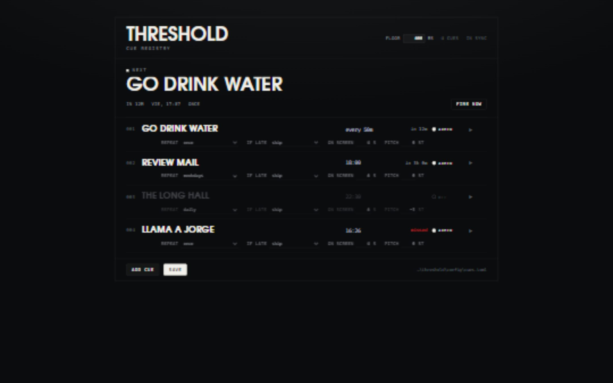

# Threshold

[](https://github.com/mconcepcionb/threshold/actions/workflows/ci)

A desktop app that interrupts your day with a full-screen typographic card and
one impact sound, at moments you schedule yourself.


> **This will get annoying fast; it's your computer.** A card takes the whole
> screen, swallows one keystroke, and makes a noise. That is the product. Schedule
> it for the transitions you actually want marked — the end of a focus block,
> "review mail", "go drink water" — not for everything.

## What it is

Not an alarm clock, and not a notification. Nothing about Threshold tries to be
polite: the card appears on one frame, with a thump, and is gone after its
Window. The bet is that a full-screen interruption you scheduled for yourself
lands differently than a banner you dismiss without reading.

- **Cues** are scheduled moments: a time or interval, a piece of text, a repeat
  rule and a late policy.
- **Cards** are what a cue produces: type, centred, over your live desktop.
- **Stings** are the sound a card lands with. One thump, procedurally generated,
  pitched per cue. The chosen voice is a 190→52 Hz sweep over a long, low tail.
- **Floor** is the guaranteed visible time at the start of a card (600 ms), when
  input passes through and cannot dismiss it. **Window** is how long the card is
  up in total (per cue, default 4 s).

Vocabulary and domain boundaries live in [GLOSSARY.md](./GLOSSARY.md); the type
system, wrap algorithm and timing are in [docs/design.md](./docs/design.md);
decisions worth remembering are in [docs/adr](./docs/adr).

## Status

Public alpha. Windows is the supported target. macOS and Linux build in CI and
are best-effort; installers are unsigned and there is no auto-update.

The domain crate and the audio renderer are unit-tested, the scheduling decision
is tested as a pure function, and the settings and overlay components have
smoke tests. The Tauri shell itself (tray, window lifecycle, audio device) is
covered by the commands in [CONTRIBUTING.md](./CONTRIBUTING.md), not by an
automated UI driver.

```
app/       the Tauri shell: tray, overlay windows, scheduler thread, sting
core/      the domain: cue model, scheduler plan, wrap solver, config, anchors
examples/  the starter cue file, which is what a fresh install starts from
docs/      design notes and the decisions worth remembering
```



## Installing

Download the installer for your platform from
[Releases](https://github.com/mconcepcionb/threshold/releases). Windows has both
an MSI and an NSIS setup. macOS and Linux builds are provided as best-effort.

The installers are **not signed**. Windows SmartScreen will warn, and macOS
Gatekeeper will require the usual right-click → Open. There is no updater yet:
to upgrade, download the new build and install it over the old one.

## Running from source

```
cd app
npm ci
npm run tauri dev
```

The app lives in the tray. A normal launch opens the settings window; closing
that window hides it rather than quitting. An autostart launch goes straight to
the tray. The card is a transparent, always-on-top layer per monitor, created at
that monitor's size. A second launch raises the running instance instead of
starting a second scheduler.

`THRESHOLD_DEMO=1` fires one card four seconds after boot, so the overlay can be
checked without waiting for a cue. `THRESHOLD_DEMO_NOTIFY=1` posts a notification
three seconds after boot, to exercise the locked-screen path. `/?window=overlay&demo`
renders the card in a plain browser, for screenshots.

## The tray

The tray menu carries **Settings…**, **Fire a test card**, **Reload config**,
**Pause for an hour**, **Resume**, **Mute the sting**, **Start at login**,
**Report a problem**, the **escape hatch** reminder, and **Quit**.

**Ctrl+Alt+Shift+Q** clears any card, returns input and focus, and stops the app
firing for an hour, at the OS level, so it works even when the UI is buried
under a stuck layer. Pause and mute are runtime state and are not persisted
across a restart.

While a Windows workstation is locked the card cannot be shown, so a cue that
fires then plays its sting and posts a notification instead. macOS and Linux do
not detect a locked screen.

## Config

The whole product is one readable TOML file, written only on save (and when a
broken file is replaced at startup).

| Platform | Default path |
|---|---|
| Windows | `%APPDATA%\threshold\cues.toml` |
| macOS | `~/Library/Application Support/threshold/cues.toml` |
| Linux | `$XDG_CONFIG_HOME/threshold/cues.toml` (usually `~/.config/threshold/cues.toml`) |

`examples/cues.toml` is the starter file: twelve cues, half instructions and half
places. A fresh install also appends one `YOU ARE HERE` one-shot due in about
ninety seconds — unless that would cross midnight.

### Top-level fields

```toml
version = 1        # optional; a newer file is rejected with a clear error
floor_ms = 600     # 100..10000
volume = 1.0       # 0..1, the sting level
overlay = "auto"   # auto | permanent | on_demand; omitted when auto
```

### Cue fields

Two required fields, and six optional ones:

```toml
[[cue]]
text = "REVIEW MAIL"          # required, up to 40 characters, drawn uppercase
at = "18:00"                  # required: "18:00" | "every 25m" | "in 25m"
repeat = "weekdays"           # once | daily | weekdays | weekly(mon,wed,fri)
late = "catch_up(20m)"        # exact | catch_up(10m) | next_opportunity
seconds = 6                   # 1..120, default 4
sting = -3                    # finite, -6..6 semitones, default 0
enabled = true                # false disarms without deleting
anchor = "2026-03-10T09:00:00+01:00"  # internal; normally lives in state.toml
```

Durations are `30s`, `25m` or `2h`. `in 25m` is an alias for `every 25m`: an
interval, not a one-shot delay. A one-shot is a wall-clock time with the default
`repeat = "once"`.

### When a cue fires

- **Wall-clock cues** (`at = "18:00"`) repeat according to `repeat`. A one-shot
  is pinned to the next occurrence of its time when it is armed; after it fires
  it has no next occurrence until it is edited or re-armed.
- **Intervals** (`at = "every 25m"`) are anchored to their last fire, so a
  restart continues the chain instead of re-phasing it. A `weekdays` interval
  jumps the weekend and keeps its time of day.
- **Late policies**: `exact` fires only if the tick notices within 2 seconds;
  `catch_up(10m)` fires inside its grace window; `next_opportunity` fires
  however late. Late decisions are made against the due time held in memory, so
  a cue missed while the app was closed is not replayed at the next start.
- **Pause and the escape hatch** advance due cues without firing them. Resuming
  does not replay the hour you were away.
- **Same text and same schedule** in two cues is rejected: the anchor sidecar
  keys a chain by exactly that pair, so two identical cues would collide.

`state.toml` sits beside the config and holds the interval anchors and one-shot
occurrences. It is written by the app, holds nothing you need to edit, and is
safe to delete: interval chains restart and spent one-shots become armable
again. `cues.toml` is written only when you save (plus the one startup recovery
path in **Problems**).

There is a small tool for checking a file without the app:

```
cd core
cargo run --bin next -- ../examples/cues.toml
```

It reads `cues.toml` and the sidecar anchors, and prints each cue's next fire,
its schedule and whether it is disarmed — which is also the answer to "why
didn't it fire?".

### Overlay modes

The card is drawn by transparent windows — one per monitor, created at that
monitor's size and never resized. Whether they stay on screen is a setting:

- `auto` (default) — permanent layers on a multi-monitor machine, shown on demand
  on a single screen
- `permanent` — the layer is always up; a card is only a DOM change, which is the
  cleanest transition and costs one composition per monitor
- `on_demand` — nothing is on screen between cards; the window is shown per card,
  which is friendlier to screen sharing and games but can flash on the first frame

Monitors added or removed while the app runs are not picked up until restart.

## Volume

One number in the settings header: the sting is a single sound, so it gets a
single level. It is saved with the config, not per cue.

## Platforms

Windows is the supported target. macOS and Linux compile in CI; always-on-top
over fullscreen apps is not available on Wayland, so the overlay may sit under
other windows there. On macOS the overlay is not placed on every Space, and
focus hand-back is Windows-only.

## Problems

Alpha software. If it breaks, the tray has **Report a problem**. A Rust panic
writes a timestamped `crash-<timestamp>.log` beside your config; the report is
not uploaded, and the tray item can attach the latest crash to a prefilled issue
at [github.com/mconcepcionb/threshold](https://github.com/mconcepcionb/threshold).

If `cues.toml` cannot be parsed, the app keeps it as
`cues.toml.broken-<timestamp>` and starts from the starter set; the settings
window shows the parse error and the path of the kept file. A transient read or
permission error does **not** move the file: the app runs from an in-memory copy
and asks you to reload once the file is readable.

## Development

```
cargo test --manifest-path core/Cargo.toml
cargo test --manifest-path app/src-tauri/Cargo.toml
cd app && npm test && npm run build
```

See [CONTRIBUTING.md](./CONTRIBUTING.md) for prerequisites, formatting, clippy,
the version check and the release process. Changes are recorded in
[CHANGELOG.md](./CHANGELOG.md).

## Licence

MIT — see [LICENSE](./LICENSE). Bundled type: TeX Gyre Adventor, GUST Font
License — see `core/assets/LICENSE-tex-gyre-adventor.txt`.
